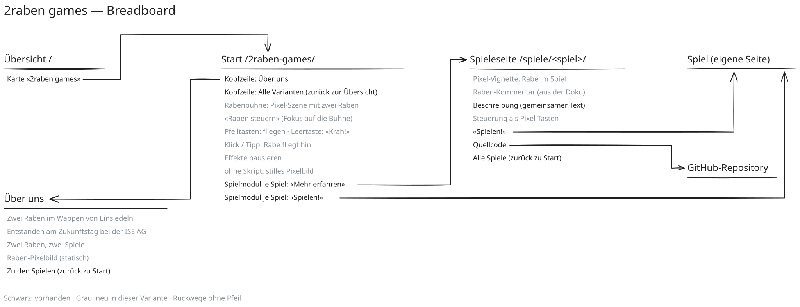
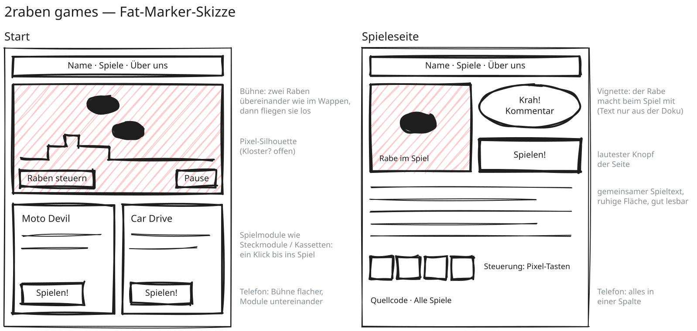

# Problem

Den Namen des Studios wählen wir, indem wir pro Kandidat eine vollständige Version
der Website vergleichen. Für «2raben games» gibt es diese Version noch nicht,
obwohl die Organisation und die Spiel-Repositories heute schon `2raben` heissen.
Der Kandidat ist der einzige, der ohne Umbenennung auskäme, und er hat noch keine
Seite, die ihn erklärt.

Ohne Erklärung ist «2raben» ein rätselhaftes Wort mit einer Zahl. Die Geschichte
dahinter liegt in Einsiedeln: Das Wappen des Bezirks Einsiedeln zeigt zwei
schwarze Raben, die übereinander fliegen. Sie gehen auf die Legende des heiligen
Meinrad zurück. In Einsiedeln, bei der ISE AG, sind am Nationalen Zukunftstag
unsere ersten Spiele entstanden: Moto Devil und Car Drive. Zwei Raben, zwei Spiele.

Die Variante muss diesen Bezug zeigen und dem Namen einen eigenen Charakter
geben: lustig und in Pixel-Art, wie ein kleines Spiel. Fertig ist sie, wenn eine
Kollegin oder ein Kollege sie von der Übersicht aus öffnet und auf einen Blick
drei Dinge erkennt: die zwei Raben, den Bezug zu Einsiedeln und den verspielten
Pixel-Stil. Ausserdem muss jedes Spiel mit einem Klick startbar sein, auf dem
Computer und auf dem Telefon.

Status: Zur Umsetzung angenommen und am 16. November 2026 als neue Variante
`2raben-games` umgesetzt. Die Problemstellung beschreibt den Ausgangspunkt; den
aktuellen Stand hält die
[Architekturdokumentation](../../architecture/README.md#2raben-games) fest. Die
Pixel-Schrift ist Jersey 10: Bei Pixelify Sans, der ersten Wahl, sehen «Z» und
«2» gleich aus.

# Solution

Die Variante wird als neue, vollständige Version angelegt (siehe
[Adding a variant](../../architecture/README.md#adding-a-variant)): Kopie einer
unveränderten Startvariante, Slug `2raben-games`, eigenes daisyUI-Theme, Eintrag in
`src/variants/index.ts` und in `src/styles/overview.css`. Danach wird sie zu einem
kleinen Pixel-Spiel, in dem zwei Raben die Gastgeber sind. Was die Website tut,
bleibt gleich. Alle Arbeit bleibt in `src/pages/2raben-games/` und
`src/variants/2raben-games/` (siehe
[ADR 0003](../../architecture/decisions/0003-give-each-variant-its-own-pages-and-styles.md)).

Die Orte und Links sind die aller Varianten: Start, eine Spieleseite pro Spiel,
Über uns, dazu die Links zu den Deployments und zum Quellcode der Spiele. Das
Breadboard zeigt, was in jedem Ort neu ist: Graue Zeilen sind neu, schwarze gibt
es schon.

Editierbare Quelle: [pitch--pixel-raben.breadboard.excalidraw](pitch--pixel-raben.breadboard.excalidraw)

Die Fat-Marker-Skizze zeigt die Anordnung, auf die es ankommt. Auf der
Startseite steht oben die Rabenbühne, darunter liegt jedes Spiel als Spielmodul
mit eigenem «Spielen!». Auf der Spieleseite stehen eine Pixel-Vignette und ein
Raben-Kommentar neben dem lautesten Knopf der Seite.

Editierbare Quelle: [pitch--pixel-raben.fat-marker.excalidraw](pitch--pixel-raben.fat-marker.excalidraw)

## Elemente

- **Pixel-Theme.** Eine knappe Palette aus dem Wappen: Rot, Rabenschwarz, Weiss,
  dazu wenige Akzente. Harte Kanten, Pixelrahmen und Schatten in festen
  Pixelschritten, kein Weichzeichnen. Eine selbst gehostete Pixel-Schrift setzt
  Name, Überschriften und Knöpfe. Fliesstext steht in einer ruhigen, gut lesbaren
  Schrift. Die Karte in der Übersicht unter `/` übernimmt die Farben wie bisher
  über das Theme.
- **Zwei Raben als Figuren.** Wir zeichnen die zwei Raben selbst in Pixel-Art und
  legen sie im Ordner der Variante ab. Sie sind als Paar erkennbar, aber nicht
  gleich, etwa durch die Grösse oder ein Detail. Sie haben wenige Posen: sitzen,
  flattern, «Krah!» rufen. Eine einzige Sprite-Quelle speist sowohl das stille
  Bild als auch die Szene, damit beide gleich aussehen.
- **Die Rabenbühne auf der Startseite (Mini-Szene).** Ein kleines Pixel-Canvas
  unter der Kopfzeile. Zu Beginn fliegen die zwei Raben übereinander wie im
  Wappen, dann brechen sie aus der Formation aus.
  - Klick oder Tipp in die Bühne: Der vordere Rabe fliegt dorthin, der zweite
    folgt immer eine Flügellänge dahinter.
  - Der Knopf «Raben steuern» fokussiert die Bühne. Dann fliegen die Pfeiltasten
    den Raben, die Leertaste lässt ihn «Krah!» in einer Pixel-Sprechblase rufen,
    und Tab oder Escape verlassen die Bühne.
  - Kleine Leerlauf-Gags zeigen Charakter: picken, blinzeln, sich gegenseitig
    anrempeln. Der Hintergrund ist eine einfache Pixel-Silhouette von Einsiedeln,
    ob mit Kloster, entscheidet die Umsetzung.
  - Ein Pause-Knopf hält alles an. Bei reduzierter Bewegung oder in einem
    verborgenen Tab steht die Szene still.
  - Ohne Skript zeigt die Bühne das stille Pixelbild der beiden Raben in
    Wappen-Formation, und der Knopf «Raben steuern» bleibt verborgen.
  - Das Canvas rechnet in niedriger Auflösung und wird in ganzzahligen Schritten
    vergrössert. Das hält die Pixel scharf und die Last klein.
  - Die Szene folgt [ADR 0004](../../architecture/decisions/0004-allow-optional-client-side-scripts-in-a-variant.md):
    ein kleines TypeScript-Modul aus dem Ordner der Variante, keine Speicherung,
    keine Netzwerkanfragen. Tasten werden nur in der fokussierten Bühne
    abgefangen. Solange das gilt, braucht es kein neues ADR.
- **Spielmodule statt Karten.** Jedes Spiel erscheint als Steckmodul oder Kassette
  im Pixel-Stil: Titel, Kurzbeschreibung, «Spielen!» und «Mehr erfahren». Auf dem
  Telefon stehen die Module untereinander, und die Bühne wird flacher.
- **Die Raben spielen mit, auf jeder Spieleseite.** Eine Pixel-Vignette zeigt einen
  Raben im Spiel, daneben steht ein kurzer Raben-Kommentar. Beide stützen sich nur
  auf die Dokumentation der Spiele:
  - Moto Devil: Dort tauchen «Raben im Sturzflug» als Hindernis auf. Kommentar
    zum Beispiel: «In Moto Devil spielen wir die Bösen. Sorry. Krah!»
  - Car Drive: Das Spiel zeigt die Strasse aus der Vogelperspektive. Kommentar
    zum Beispiel: «Vogelperspektive? Das ist unsere Perspektive.» Ein Rabe kommt
    in Car Drive selbst nicht vor, und der Text behauptet das auch nicht.

  Darunter folgt der gemeinsame Spieltext auf einer ruhigen Fläche, gefolgt von
  der Steuerung als Pixel-Tasten. Die Kommentare liegen pro Spiel-ID im Ordner der
  Variante. Der Build schlägt fehl, wenn ein Spiel keinen Kommentar hat, damit
  ein neues Spiel nie halb eingekleidet erscheint.
- **Die Namensgeschichte auf «Über uns».** Ein kurzer Abschnitt erzählt sie: Das
  Wappen des Bezirks Einsiedeln zeigt zwei Raben. Unsere ersten Spiele sind am
  Nationalen Zukunftstag 2026 bei der ISE AG in Einsiedeln entstanden. Zwei
  Raben, zwei Spiele. Die Meinrad-Legende bekommt höchstens einen
  kinderfreundlichen Satz. Dazu kommt ein stilles Pixelbild der beiden Raben.
- **Lustige Stimme im eigenen Text.** Leitsatz, Einleitung, Knöpfe, «Über uns»
  und Fusszeile bekommen den Ton eines kleinen Arcade-Spiels, auf Deutsch und in
  Schweizer Rechtschreibung. Zum Beispiel als Leitsatz «Zwei Raben. Zwei Spiele.
  Viel Krah.» und in der Fusszeile «Beim Programmieren wurden keine Raben
  verletzt.». «Spielen!» bleibt der Hauptknopf.

Zur Umsetzung gehören auch die Einträge für die neue Variante in der
[Architekturdokumentation](../../architecture/README.md) und in der Pitch-Übersicht.

# Security

Die Pixel-Schrift wird mit der Variante ausgeliefert (als Paket oder als Datei im
Ordner der Variante) und nicht von Google Fonts oder einem anderen Dritten
geladen. Die Website stellt damit weiterhin keine Anfragen ausserhalb ihres
eigenen Origins und der Deployments der Spiele. Sprites und Bilder sind eigene
statische Dateien. Das Szenenskript wird aus dem Ordner der Variante gebündelt.
Es verarbeitet Zeiger-, Touch- und Tastenereignisse nur innerhalb der Seite,
speichert nichts und sendet nichts. Die Seite nennt die Schulstufe höchstens
allgemein und zeigt keine Namen, Fotos oder anderen Angaben zu Kindern.

# Rabbit Holes

- **Das echte Wappen.** Gemeinde- und Bezirkswappen sind öffentliche Hoheitszeichen.
  Wir bilden weder den Schild noch das Wappen ab und nutzen es nicht als Logo. Die
  Variante zeigt eigene Raben, die auf das Wappen anspielen. Die Beschreibung des
  Wappens (Farben, Haltung der Raben) wird vor dem Veröffentlichen an einer
  verlässlichen Quelle geprüft, zum Beispiel beim Bezirk Einsiedeln. Das
  Klosterwappen zeigt dieselben Raben auf Gold; wir verwechseln die beiden nicht.
- **Die Legende ist eine Mordgeschichte.** Die Raben verfolgten der Legende nach
  Meinrads Mörder. Für eine lustige Seite, die Kinder und Familien lesen, reicht
  ein Satz ohne Einzelheiten, oder wir lassen die Legende weg.
- **Pixel-Art frisst die Zeit.** Wir begrenzen das Sprite-Set: ein Rabenkörper in
  zwei Varianten, drei Posen, zwei Vignetten und ein Bühnenhintergrund. Stockt eine
  Vignette, nutzt die Spieleseite die Grundpose. Jede Grafik ist eigene Arbeit oder
  klar für diesen Zweck lizenziert.
- **Verschwommene Pixel.** Skalieren mit Bruchzahlen macht Pixel-Art matschig.
  Bilder und Canvas werden in ganzzahligen Schritten vergrössert und ohne Glättung
  dargestellt. Die Pixel-Schrift steht nur in Grössen, die zu ihrem Raster passen.
- **Lesbarkeit.** Pixel-Schrift, Rot und Schwarz kämpfen mit der Lesbarkeit. Die
  Pixel-Schrift steht nur in kurzen Texten. Fliesstext liegt auf ruhigen Flächen
  mit WCAG-AA-Kontrast, und Rot ist Fläche oder Akzent, keine Textfarbe auf Schwarz.
  Die Schrift wird zuerst nach Umlauten und Guillemets ausgewählt («Krah!», «Über uns»).
- **Die Mini-Szene wird zum dritten Spiel.** Punkte, Ziele, Levels oder Highscores
  würden die Arbeit sprengen und von den echten Spielen ablenken. Die Bühne ist
  ein Spielzeug ohne Gewinnen und Verlieren.
- **Tasten und Touch.** Die Szene darf Tab, Scrollen und Browserbefehle nicht
  übernehmen. Pfeiltasten und Leertaste fängt sie nur ab, solange die Bühne
  fokussiert ist. Auf dem Telefon reagiert sie auf Tippen, ohne das Scrollen der
  Seite zu blockieren. Ein virtuelles Steuerkreuz gibt es nicht.
- **Bewegung.** Flattern und Sprechblasen sind willkommen, Blinken und schnelle
  Helligkeitswechsel nicht. Bei `prefers-reduced-motion` steht alles still.
- **Nähe zu November Games.** Auch dort gibt es eine interaktive Einsiedler Szene
  mit Kloster. 2raben games unterscheidet sich durch Tageslicht, Pixel-Art und
  die Raben als Figuren. Code wird nicht aus der anderen Variante importiert;
  Varianten bleiben unabhängig.
- **Kommentare entfernen sich von den Fakten.** Die Raben-Kommentare erzählen
  nach, was die Dokumentation der Spiele sagt, und erfinden nichts dazu. Sie
  bleiben kurz und werden geprüft, wenn sich ein Spieltext ändert.
- **Die ISE AG nennen.** Sie erscheint nur im Text, ohne Logo oder Gestaltung,
  und wir fragen sie vorher, ob sie damit einverstanden ist.

# No-Gos

- Kein echtes Wappen, kein Wappenschild, kein Klosterwappen, kein Logo der ISE AG
  und keine Gestaltung der Gemeinde oder des Bezirks.
- Keine Sprites, Screenshots oder Builds aus den Spiel-Repositories; die Raben
  und Vignetten sind eigene Zeichnungen.
- Keine Änderungen an anderen Varianten, an den gemeinsamen Spieltexten, an
  `src/lib/` oder an der Übersichtsseite; die Übersicht bekommt nur den
  Theme-Import und den Listeneintrag, die jede Variante braucht.
- Keine neuen Orte oder Seiten, keine Konten, Ranglisten, Highscores oder
  gespeicherten Einstellungen.
- Keine Geräusche oder Chiptune-Musik.
- Keine Spiel-Engine, keine Grafik- oder Animationsbibliothek, kein
  Client-Framework und kein Inhalt, der ohne Skript fehlt.
- Keine Spielfunktionen, die nicht in der Dokumentation der Spiele stehen, und
  kein Versprechen, dass die Spiele auf dem Telefon steuerbar sind.
- Keine endgültige Namenswahl und keine Umbenennung der Organisation oder der
  Repositories.
