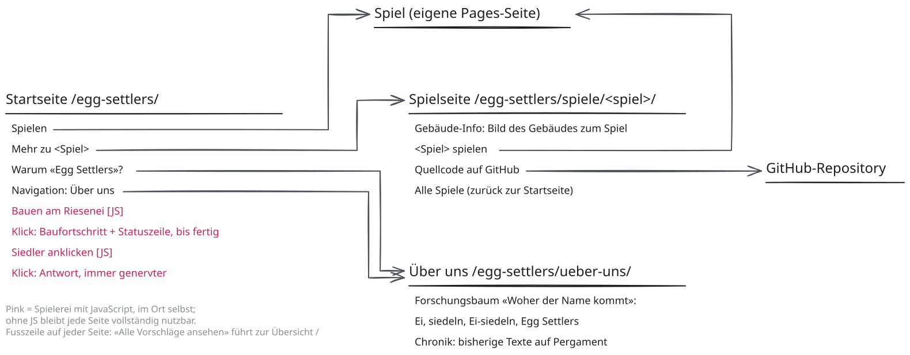

# Problem

Egg Settlers is one of four name candidates, but its version of the site is still
the shared starting point: the same layout and pages as the other variants, in a
copy of daisyUI's cupcake colors. Colleagues who compare the candidates see four
sites that differ only in name and color, so they judge the names as bare words,
not as studios.

That hurts Egg Settlers most, because the name only works once you get the joke.
It is the word-for-word English translation of "Ei-siedeln": "Ei" is egg,
"siedeln" is to settle, and said aloud, "Ei-siedeln" is Einsiedeln. Without that,
"Egg Settlers" reads as an odd English phrase. With it, the name is playful and
local, and it already sounds like the title of a strategy game: settlers who
found a village and, being egg settlers, build an enormous egg in the middle of
it.

The experiment: give the variant the look of a strategy game in which the
settlers build a giant egg, with many illustrations, a few playful interactions,
and the pun explained on the site. Colleagues can then decide whether they want
to be the Egg Settlers. The experiment succeeds when the three existing pages of
`/egg-settlers/` carry that look, and someone who opens the variant gets the
joke without being told.

# Solution

The variant looks like a strategy game in the vein of building and settlement
games, without copying any one of them. Its home page is the settlement, and the
giant egg is its construction site. Everything happens inside
`src/pages/egg-settlers/` and `src/variants/egg-settlers/`. The routes, the shared
game texts and the links to the games stay as they are.

The breadboard shows the places, what visitors can do there, and where it leads.
Pink affordances are interactions that need JavaScript; all of them happen in
place, and every page stays complete without them.

The fat-marker sketch shows the rough arrangement of the home page and of the
name's tech tree on the about page.

Editable sources: [breadboard](pitch--egg-settlers.breadboard.excalidraw) and
[fat-marker sketch](pitch--egg-settlers.fat-marker.excalidraw).

## Elements

1. **Strategy-game theme.** `theme.css` and `styles.css` take on the genre's
   look: interface panels with bevelled stone or wood edges, parchment for
   longer texts, earthy colors with a meadow green and the egg's shell color as
   accents. Headings use one self-hosted display font with a carved or
   hand-lettered feel; body text stays a plain, readable font.
2. **Resource bar.** The header becomes the bar along the top of the screen,
   with the studio name, the navigation, and two or three counters. Only
   "Spiele" counts something real, the number of games in the collection; the
   others are obvious jokes, such as "Ideen: viele". The counters are text, not
   buttons.
3. **AI-generated illustrations.** A small, fixed set of about eight to ten
   images in one style, seen from the slightly raised angle these games use:
   - the settlement: hills, a few houses, a loose two-tower silhouette in the
     background as a nod to Einsiedeln, and in the middle the giant egg;
   - the giant egg's scaffolding as a separate layer over the finished egg;
   - a settler, a small round figure with a tool, for the clickable settler;
   - one building per game, in a setting its documentation describes: a stunt
     track with ramps for Moto Devil, a garage by a three-lane road for Car
     Drive;
   - four icons for the name's tech tree.

   The images live in the variant's folder, with a file beside them that lists
   the tool, date and prompt for each image. Astro's image pipeline resizes and
   compresses them at build time. Decorative images get an empty `alt`; the
   others get German alternative text.
4. **The home page as the settlement.** The settlement picture fills the top,
   with the egg under construction, the settler, a "Bauen" button and a progress
   bar beside it. The picture has no clickable areas; every action is an
   ordinary button or link. Below it, each game is a building in an info panel
   like the one a strategy game shows for a selected unit: picture, name,
   tagline, and the unchanged "Spielen" and "Mehr zu" actions. A "Warum «Egg
   Settlers»?" teaser links to the about page.
5. **Game pages as building info.** The game's building stands beside the title;
   texts, controls and links stay unchanged, set in the theme's panels.
6. **The name's tech tree "Woher der Name kommt".** On the about page, four
   stages connected like a research path: Ei, siedeln, Ei-siedeln (Einsiedeln),
   Egg Settlers. Each stage has an icon and one sentence of explanation, in
   HTML. The existing about texts follow as a chronicle on parchment panels.
7. **Two playful interactions**, as progressive enhancement:
   - **Build the giant egg.** Each click on "Bauen" advances construction by one
     step: the progress bar grows, the scaffolding gives way to more of the
     finished egg, and a status line reports what the settlers are doing. After
     a handful of steps the egg is finished and the settlers celebrate. A reload
     starts over.
   - **Click the settler.** Each click gets a reply in a speech bubble, the
     genre's running joke: polite at first, then increasingly fed up.

   One small script in the variant's folder, bundled by Astro, with no library,
   within the rules of
   [ADR 0004](../../architecture/decisions/0004-allow-optional-client-side-scripts-in-a-variant.md).
   Without JavaScript, the egg stands under construction with "Im Bau", the
   "Bauen" button and the settler's replies stay hidden, and every link works.
   With reduced motion requested, construction and replies change without
   animation.
8. **Recorded decisions.** The interactions need no new decision; ADR 0004
   already allows them. Keeping AI-generated images with their prompts in the
   repository is new: implementing this pitch records it in an ADR and updates
   the [architecture documentation](../../architecture/README.md).

# Security

- **Script.** First-party, bundled with the variant, and limited to toggling
  classes and attributes and showing fixed text that is already in the page. It
  makes no network requests, stores nothing, and reads no input other than
  clicks. It sets no HTML from strings.
- **Third parties.** Fonts and images are committed to the repository and served
  from the site. Nothing loads from a font service, a CDN, or the image
  generator's servers, so visitors make no requests to third parties.
- **Image metadata.** Generated files can carry metadata such as the prompt,
  account details or location. Strip it before committing, because the source
  files sit in a public repository even though the build re-encodes them.
- **Credentials.** Images are generated by hand outside the repository. No
  generator API keys go into the repository, the build, or CI.

# Rabbit Holes

- **Too close to a real game.** The variant borrows the genre's conventions:
  resource bar, build button, progress bar, info panels and a tech tree. It takes
  nothing from a particular game: no names, logos, interface graphics, fonts,
  units, buildings, music or sounds from Die Siedler, Age of Empires or any
  other title. Neither the site nor the image prompts name such games or their
  studios.
- **A real game on the home page.** Collecting resources, scrolling the map, a
  minimap or moving units would each swallow the work. The settlement is a
  picture, and the only game-like actions are the two interactions above.
- **Controls that do nothing.** Game-like interfaces invite decorative buttons.
  Every control does something; decorative elements, such as the counters, are
  not buttons.
- **Construction stages.** Separate images for each stage would not match each
  other. Use one finished egg and one scaffolding layer, and reveal the egg step
  by step with CSS.
- **Inconsistent style.** Generated images drift from one to the next. Write one
  style description and reuse it word for word in every prompt, generate the
  whole set in one sitting with one tool, and use the settlement as a reference
  image where the tool supports it. If a motif still fails after a few attempts,
  replace it with a simpler one instead of retouching it.
- **Lettering in images.** Generators garble letters, especially German ones. No
  image contains text; every word on the page is HTML.
- **Rights and terms.** Use a generator whose terms allow publishing its output
  on a public website and in a public repository, and record the terms' date
  with the prompts. Prompts never name artists, games, characters or brands.
  Generated images may not be protectable as the studio's own work: fine for
  comparing names, but revisit before any of them becomes a logo.
- **Einsiedeln itself.** The joke is about the place name. The town appears only
  as a loose two-tower silhouette: no accurate monastery, no religious motifs.
- **Describing the games.** Buildings show only what the games' documentation
  describes. No screenshots, sprites or other game assets, and no invented
  features.
- **File size.** The settlement picture can make the home page heavy. Keep the
  committed sources at a sensible maximum size, let the build produce WebP in
  sizes for phones and desktops, and lazy-load everything below the settlement.
  Check the page weight in the browser.
- **New games.** The game texts are shared, so a game can appear without a
  building in this variant. Its panel and game page then show a generic house.
- **Phone width.** The resource bar wraps, the settlement picture is cropped
  around the egg, and the build controls and info panels stack below it.
- **Accessibility.** "Bauen" and the settler are real buttons with German names
  and a visible focus. The progress bar has a label, and status lines and
  replies are announced politely to screen readers. Check the contrast of text
  on stone, wood and parchment.
- **Display font.** Decorative fonts often lack umlauts or «». Check Ä, Ö, Ü, ä,
  ö, ü, « and » before choosing, use an openly licensed font, and commit the
  font file with its license to the variant's folder instead of adding a
  dependency.

# No-Gos

- No changes outside the variant's two folders, apart from the ADR and
  architecture documentation. The overview card at `/` changes only through the
  new theme colors.
- No playable strategy game: no resources to collect, no scrolling map, no
  minimap, no units to command.
- No recreation of a particular game's look, names, interface or sounds.
- No music or sound effects, no saved state, no high scores.
- No new pages; the name explanation lives on the about page.
- No client-side framework, animation library, CDN, font service or analytics.
- No image generation during the build or in CI.
- No logo or final brand identity; the illustrations serve the name comparison.
- No game screenshots or game assets, and no new claims about the games.
- No changes to the shared game texts.
- No dark theme.
