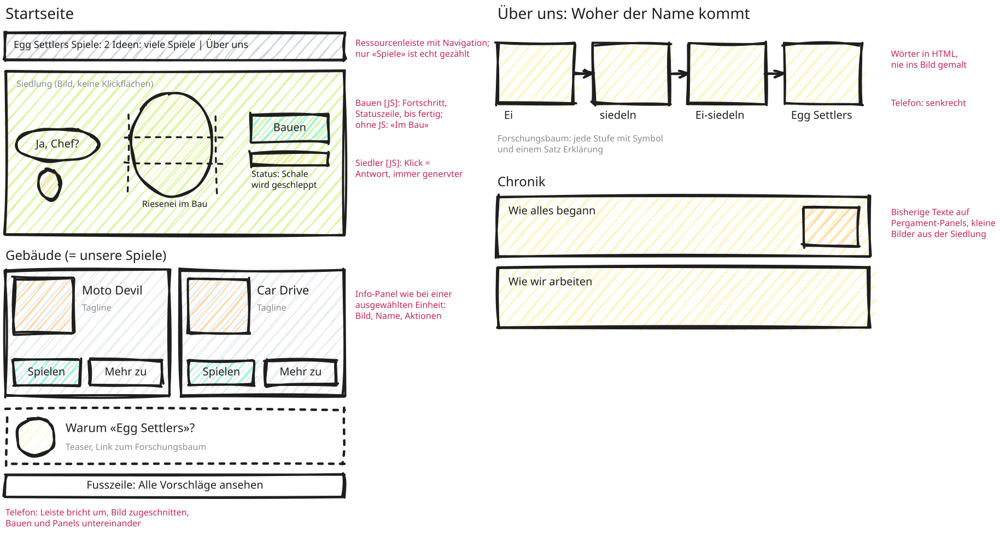

# Problem

Egg Settlers is one of four name candidates, but its version of the site is still
the shared starting point: the same layout and pages as the other variants, in a
copy of daisyUI's cupcake colors. Colleagues who compare the candidates see four
sites that differ only in name and color, so they judge the names as bare words,
not as studios.

That hurts Egg Settlers most, because the name only works once you get the joke.
It is the word-for-word English translation of "Ei-siedeln": "Ei" is egg,
"siedeln" is to settle, and said aloud, "Ei-siedeln" is Einsiedeln. Without that,
"Egg Settlers" reads as an odd English phrase. With it, the name is playful and
local, and it already sounds like the title of a strategy game: settlers who
found a village and, being egg settlers, build an enormous egg in the middle of
it.

The experiment: give the variant the look of a strategy game in which the
settlers build a giant egg, with many illustrations, a few playful interactions,
and the pun explained on the site. Colleagues can then decide whether they want
to be the Egg Settlers. The experiment succeeds when the three existing pages of
`/egg-settlers/` carry that look, and someone who opens the variant gets the
joke without being told.

# Solution

The variant looks like a strategy game in the vein of building and settlement
games, without copying any one of them. Its home page is the settlement, and the
giant egg is its construction site. Everything happens inside
`src/pages/egg-settlers/` and `src/variants/egg-settlers/`. The routes, the shared
game texts and the links to the games stay as they are.

**Amended during implementation.** At the studio's request, the settlement
grew from a framed picture into the home page's fullscreen background, loosely
after Einsiedeln with the Sihlsee, the Sihl, the Alp and the monastery; visitors
can have houses built on it; the game pictures became more detailed; and the
game pages gained practice grounds like Schafbock Studio's key demos. The
elements, rabbit holes and no-gos below describe the amended scope; the
sketches still show the original shaping, with the picture beside the
construction panel.

The breadboard shows the places, what visitors can do there, and where it leads.
Pink affordances are interactions that need JavaScript; all of them happen in
place, and every page stays complete without them.

The fat-marker sketch shows the rough arrangement of the home page and of the
name's tech tree on the about page.

Editable sources: [breadboard](pitch--egg-settlers.breadboard.excalidraw) and
[fat-marker sketch](pitch--egg-settlers.fat-marker.excalidraw).

## Elements

1. **Strategy-game theme.** `theme.css` and `styles.css` take on the genre's
   look: interface panels with bevelled stone or wood edges, parchment for
   longer texts, earthy colors with a meadow green and the egg's shell color as
   accents. Headings use one self-hosted display font with a carved feel,
   Cinzel; body text stays a plain, readable font.
2. **Resource bar.** The header becomes the bar along the top of the screen,
   with the studio name, the navigation, and two or three counters. Only
   "Spiele" counts something real, the number of games in the collection; the
   others are obvious jokes, such as "Ideen: viele". The counters are text, not
   buttons.
3. **AI-drawn pixel-art illustrations.** A fixed set of drawings in one style:
   top-down pixel art like the maps of 1990s settlement games, on a meadow that
   also covers the whole page:
   - the settlement, loosely after Einsiedeln with north at the top: the
     Sihlsee with its dam at the north end, the Sihl flowing out of the dam,
     the Alp coming from the south through the village into the Sihl, the
     monastery with its square, houses, farms, woods and settlers, men and
     women, at work and on the roads, and in the middle the giant egg;
   - the giant egg's wooden frame and crane as a separate layer over the
     finished egg;
   - the foreman, a settler woman with a tool, for the clickable settler;
   - one picture per game, in a setting its documentation describes: Moto
     Devil's stunt bike in side view with a ramp, spikes from the ground, a
     loop, a raven and a gravestone; Car Drive's three lanes from above with
     traffic, a truck, a heart, a shield, the boost and the garage;
   - four icons for the name's tech tree.

   No image generator was available while building this, so Claude draws the
   illustrations as SVG in the variant's folder, as the other variants do: a
   small renderer turns color grids, hand-drawn or generated with a fixed
   seed, into crisp SVG paths at build time. Decorative images are hidden from
   screen readers; the others get German alternative text.
4. **The home page as the settlement.** The settlement map fills the screen
   behind the page and stays put while the page scrolls over it. Over the map
   lie the intro and a command bar with the foreman, the progress bar, the
   status, "Bauen" and "Haus bauen"; the egg under construction stays free in
   the middle. The map's only clickable use is asking for a house (element 7);
   every other action is an ordinary button or link. Below, each game is a
   building in an info panel
   like the one a strategy game shows for a selected unit: picture, name,
   tagline, and the unchanged "Spielen" and "Mehr zu" actions. A "Warum «Egg
   Settlers»?" teaser links to the about page.
5. **Game pages as building info.** The game's picture stands beside the
   title; texts, controls and links stay unchanged, set in the theme's panels.
   A practice ground follows (element 7).
6. **The name's tech tree "Woher der Name kommt".** On the about page, four
   stages connected like a research path: Ei, siedeln, Ei-siedeln (Einsiedeln),
   Egg Settlers. Each stage has an icon and one sentence of explanation, in
   HTML. The existing about texts follow as a chronicle on parchment panels.
7. **Playful interactions**, as progressive enhancement:
   - **Build the giant egg.** Each click on "Bauen" advances construction by one
     step: the progress bar grows, the scaffolding gives way to more of the
     finished egg, and a status line reports what the settlers are doing. After
     a handful of steps the egg is finished and the settlers celebrate. A reload
     starts over.
   - **Click the settler.** Each click gets a reply in a speech bubble, the
     genre's running joke: polite at first, then increasingly fed up.
   - **Have a house built.** A click on free meadow sends a crew from the
     egg's plaza; they fell the trees on the plot, work at a building site,
     and a house rises before they walk back. Where houses may stand comes
     from a grid computed at build time, so they keep off water, roads,
     fields, buildings and each other. "Haus bauen" does the same for
     keyboards, at a free spot near the village.
   - **Practice grounds.** Each game page has a small simulation with
     simplified rules from the game's own text, driven by the keys of its
     controls table or by on-screen buttons. A demonstration plays until
     somebody takes over: Moto Devil's course with a ramp, saltos, the jet,
     spikes from the ground and a goal that drives away; Car Drive's three
     lanes with traffic both ways, blinking cars, trucks from 4000 metres,
     hearts, a shield and the boost. They are labelled as practice, not the
     games.

   Small scripts in the variant's folder, bundled by Astro, with no library,
   within the rules of
   [ADR 0004](../../architecture/decisions/0004-allow-optional-client-side-scripts-in-a-variant.md).
   Without JavaScript, the egg stands under construction with "Im Bau", the
   buttons, the settler's replies and the practice grounds stay hidden, and
   every link works. With reduced motion requested, the map stands still,
   construction and replies change without animation, houses appear at once,
   and the practice grounds play no demonstration.
8. **Recorded decisions.** No new ADR: ADR 0004 already allows the
   interactions, and SVG illustrations in components follow the other variants.
   The [architecture documentation](../../architecture/README.md) describes the
   variant.

# Security

- **Scripts.** First-party, bundled with the variant, and limited to toggling
  classes and attributes, moving SVG elements, creating `<use>` sprites with
  `createElementNS`, and showing fixed text from the page or the scripts. They
  make no network requests, store nothing, and read no input other than
  clicks, pointer positions on the map and the practice grounds' keys. They
  set no HTML from strings.
- **Third parties.** The font is bundled from an npm package and the
  illustrations are inline SVG, both served from the site. Nothing loads from a
  font service or a CDN, so visitors make no requests to third parties.
- **Image metadata and credentials.** The illustrations are source code, not
  generated files, so they carry no hidden metadata, and no image generator or
  API key is involved.

# Rabbit Holes

- **Too close to a real game.** The variant borrows the genre's conventions:
  resource bar, build button, progress bar, info panels and a tech tree. It takes
  nothing from a particular game: no names, logos, interface graphics, fonts,
  units, buildings, music or sounds from Die Siedler, Age of Empires or any
  other title. A screenshot of such a game served only as a reference for the
  general look; nothing is traced from it, and its signature details, such as
  flags marking every road junction or the ornamental map frame, stay out.
  The site does not name such games or their studios.
- **A real game on the home page.** Collecting resources, scrolling the map, a
  minimap or commanding units would each swallow the work. The settlement is a
  picture with a few bounded actions: building the egg, poking the foreman and
  asking for a house. Houses cost nothing, follow a fixed grid and stop at 24.
- **Practice grounds that grow into games.** Each simulation stays one short
  course or one stretch of road with the rules the game's text names, and no
  levels, saving or scores beyond the counters on screen.
- **Controls that do nothing.** Game-like interfaces invite decorative buttons.
  Every control does something; decorative elements, such as the counters, are
  not buttons.
- **Construction stages.** Separate images for each stage would not match each
  other. Use one finished egg and one scaffolding layer, and reveal the egg step
  by step with CSS.
- **Inconsistent style.** Keep one palette, one light direction (upper left)
  and one pixel scale in every drawing, and prefer simple shapes over detail.
  If a motif does not work, replace it with a simpler one.
- **Page weight.** Pixel art as SVG can grow fast. Draw repeated sprites once
  and place them with `<use>`, fill the meadow with a pattern tile, and merge
  pixels into runs per row.
- **Lettering in images.** No drawing contains letters. The names of the lake
  and the rivers are SVG text on the map, so they stay real text.
- **Rights.** The drawings are original SVG and name no artists, games,
  characters or brands. AI-made images may not be protectable as the studio's
  own work: fine for comparing names, but revisit before any of them becomes a
  logo.
- **Einsiedeln itself.** The joke is about the place name. Originally the town
  was to appear only as a loose two-tower silhouette; at the studio's request
  the map now shows a simplified monastery and the Sihlsee, Sihl and Alp. It
  stays a loose picture: the waters follow reality's order, but the lake lies
  west of the village instead of east to keep the composition, and the
  monastery carries no religious symbols.
- **Describing the games.** Pictures and practice grounds show only what the
  games' documentation describes. No screenshots, sprites or other game
  assets, and no invented features.
- **New games.** The game texts are shared, so a game can appear without a
  building in this variant. Its panel and game page then show a generic house.
- **Phone width.** The resource bar wraps, the map is cropped around the egg
  and moves down behind the taller resource bar, and the intro and command bar
  sit above and below the egg. On wide screens the intro moves down beside the
  command bar so the dam and rivers at the top stay visible.
- **Accessibility.** "Bauen", "Haus bauen" and the settler are real buttons
  with German names and a visible focus; clicking the map is a shortcut, never
  the only way. The practice grounds are focusable groups with buttons for
  every key. The progress bar has a label, and status lines and replies are
  announced politely to screen readers. Check the contrast of text on stone,
  wood and parchment.
- **Display font.** Decorative fonts often lack umlauts or «». Check Ä, Ö, Ü, ä,
  ö, ü, « and » before choosing, and use an openly licensed font, self-hosted
  through Fontsource like Schafbock Studio's.

# No-Gos

- No changes outside the variant's two folders, apart from the font dependency
  and the architecture documentation. The overview card at `/` changes only
  through the new theme colors and tagline.
- No playable strategy game: no resources to collect, no scrolling map, no
  minimap, no units to select or command. The practice grounds are warm-ups,
  not the games.
- No recreation of a particular game's look, names, interface or sounds.
- No music or sound effects, no saved state, no high scores.
- No new pages; the name explanation lives on the about page.
- No client-side framework, animation library, CDN, font service or analytics.
- No image generation during the build or in CI.
- No logo or final brand identity; the illustrations serve the name comparison.
- No game screenshots or game assets, and no new claims about the games.
- No changes to the shared game texts.
- No dark theme.
