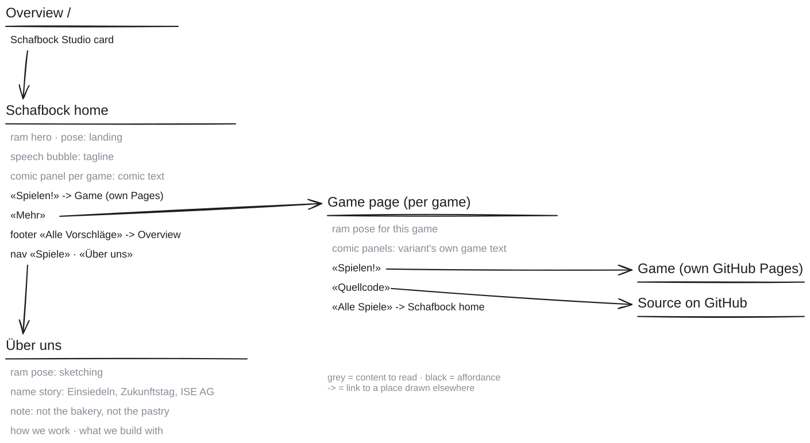
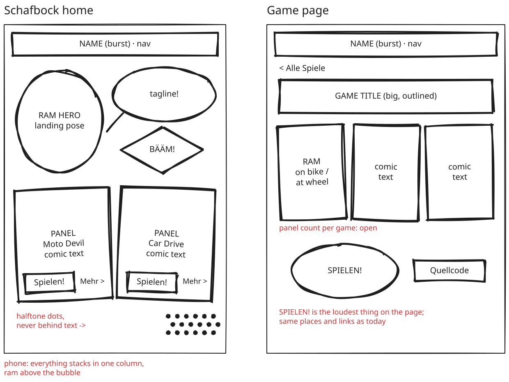

# Problem

Colleagues will choose the studio's name by comparing one complete version of the
site per candidate. Today the Schafbock Studio version is a copy of the shared
starting point with daisyUI's "retro" colors: its pages look like every other
variant's, so the comparison is between four words, not four identities.

The name has a story worth telling. Our first games were built on the Nationaler
Zukunftstag at ISE AG in Einsiedeln, and the Schafbock is an Einsiedeln
speciality. A reader who knows the pastry will assume a bakery connection; a
reader who doesn't will see only a sheep. The variant has to explain the nod to
Einsiedeln, make clear that the studio has nothing to do with the bakery or the
baked Schafbock, and give the name its own character: a ram with a hard head,
"Kleine Spiele mit Dickschädel".

The variant is done when a colleague who opens it from the overview recognizes it
at a glance as funny, pop-art and superhero, and can still start either game in
one click, on desktop and on a phone.

# Solution

Turn the Schafbock variant into a comic book starring a superhero ram, without
changing what the site does. All work stays in `src/pages/schafbock-studio/` and
`src/variants/schafbock-studio/` (see
[ADR 0003](../../architecture/decisions/0003-give-each-variant-its-own-pages-and-styles.md)).

The places and links stay as they are: home, game page per game, Über uns, and the
links out to each game's own deployment and source. The breadboard marks what
changes inside each place: grey lines are new content, black lines the
affordances that already exist.

Editable source: [pitch--pop-art-superhero.breadboard.excalidraw](pitch--pop-art-superhero.breadboard.excalidraw)

The fat-marker sketch shows the arrangement that matters: the ram and a speech
bubble carry the home page, every game is a comic panel with its play button,
and the game page opens with a short comic strip before the loudest button on the
page.

Editable source: [pitch--pop-art-superhero.fat-marker.excalidraw](pitch--pop-art-superhero.fat-marker.excalidraw)

## Elements

- **Pop-art theme.** The variant's `theme.css` replaces the retro copy with loud
  primaries on a light paper base, thick black outlines and hard offset shadows.
  Halftone dots appear as decoration behind shapes, never behind text. One
  comic display face for the name, headings, bursts and buttons; body text stays
  in a plain, readable face. The overview card at `/` picks up the new colors
  through the theme, as it does today.
- **Comic devices.** Speech bubbles, sound-effect bursts ("BÄÄM!", "MÄÄH!") and
  slightly tilted panels with gutters, built in CSS and SVG. The name in the
  header sits in a burst.
- **Effects on pointer and keyboard.** The ram's eyes follow the pointer, layers
  shift with it, panels lean toward it. A click or a typed letter pops up a
  sound-effect word and makes the ram nod. Each game page has a small key demo
  ("Trockenübung") with the game's own keys. These need a small client-side
  script, which stays optional:
  [ADR 0004](../../architecture/decisions/0004-allow-optional-client-side-scripts-in-a-variant.md).
- **The ram hero, in four poses.** One original character, a ram with mask and
  cape, drawn as SVG and kept in the variant's folder:
  - landing pose on the home page, next to the tagline in a speech bubble;
  - on the motorbike on the Moto Devil page;
  - behind the wheel on the Car Drive page;
  - sketching on paper on Über uns ("Angefangen hat alles mit Skizzen auf
    Papier").

  The landing pose comes first; a page whose pose is not drawn yet uses it.
- **Comic voice in the variant's own text.** Tagline, home intro, button labels,
  Über uns and the footer line are rewritten in a playful superhero voice, in
  German with Swiss spelling. For example: «Spielen!» stays the main button, the
  hero bubble might say «Mäh? Nein: BÄÄM!».
- **Comic copy for each game.** The variant keeps its own short comic text per
  game, keyed by the game's id, in `src/variants/schafbock-studio/`. The home
  panels and the game page's comic strip use it. Every fact in it comes from the
  shared game text or the game's repository; it retells, it does not add. The
  game page keeps the shared Markdown below the strip, restyled, because it holds
  the details the comic should not repeat: levels, controls, upgrades. The build
  fails when a game has no comic copy, the way `src/variants/index.ts` fails on a
  missing variant, so a new game is never shown half-dressed.
- **The name story on Über uns.** A short section explains the name: the games
  were born on the Nationaler Zukunftstag 2026 at ISE AG in Einsiedeln, the
  Schafbock is an Einsiedeln speciality, and our Schafbock is a superhero with a
  hard head. One plain sentence states that the studio has nothing to do with the
  bakery or the baked Schafbock. For example: «Mit dem Gebäck und der Bäckerei
  haben wir nichts zu tun – unser Schafbock backt keine Weggli, er macht
  Spiele.»

# Security

The display font is self-hosted with the variant (a package or a file in the
variant's folder), not loaded from Google Fonts or another third party, so the
site still makes no requests outside its own origin and the games' deployments.
The SVG drawings are our own static files. The effects script is bundled from the
variant's folder; it reads pointer and key events in the page only, makes no
network requests, stores nothing, and never sends what was typed anywhere.

# Rabbit Holes

- **Drawing the ram.** Four consistent poses can swallow the whole project.
  Build one flat base figure from simple shapes with thick outlines, which suits
  pop-art, and re-pose it by moving limbs and swapping props. Ship with the
  landing pose alone if the others stall. Every drawing must be our own work or
  clearly licensed for this use.
- **Superhero look-alikes.** Capes and masks are generic; emblems, costume
  colors, logos and names of existing heroes are not. The ram's chest shows
  nothing, or our own mark, never a parody of a known emblem.
- **Readability.** Halftone, tilted panels and a comic face fight legibility.
  Keep text horizontal or nearly so, on flat backgrounds, at WCAG AA contrast;
  use the display face only for short text, and check umlauts and guillemets
  render in it ("BÄÄM!", «Spielen!»). Choose the font for umlaut support first.
- **Motion.** Wobbles, pops and flying words are welcome, and switched off under
  `prefers-reduced-motion`. Effects never take keys away from the page: they only
  listen, except inside a focused key demo.
- **Phone width.** Speech bubbles and side-by-side panels break first. Everything
  stacks into one column; the ram sits above its bubble, and the bubble's tail
  points down instead of sideways.
- **Comic copy drifting from the facts.** The comic text retells the shared game
  text and can go stale when a game changes. Keep it short, and review it against
  the shared Markdown whenever a game's text changes.
- **Naming ISE AG.** Mention the company in text only, no logo or branding, and
  confirm with them that they are fine being named on the site.

# No-Gos

- No bakery or pastry imagery: no biscuit, no mold shape, no bakery names, logos
  or recipes. The bakery appears only in the one sentence that says we are not it.
- No characters, emblems or names borrowed from existing comics or superheroes.
- No changes to the shared game Markdown, `src/lib/`, the overview page, or the
  other variants. The ram does not appear on the overview at `/`.
- No new places or pages, no change to where links lead.
- No game builds, sprites or screenshots copied from the game repositories; the
  ram on the motorbike and in the car is our own drawing.
- No animation library, client framework or sound effects, and no content that
  depends on the script.
- No dark theme; the comic is printed on light paper.
